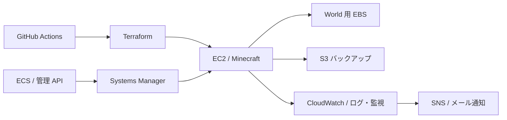

# Minecraft Platform

Minecraft サーバーを題材に、AWS のインフラを構築・運用・復旧するための学習用プラットフォームを作っています。Terraform で環境を再現し、問題が起きたときの調査や復旧、演習後の撤去までを一通り実践するプロジェクトです。

## 完成するとできること

- **環境を作る**：Terraform でネットワーク、Minecraft サーバー、World 用ディスクを構築し、本人が接続して動作を確認する。
- **状態を調べる**：CPU・メモリ・ディスクの使用状況とログを確認し、CPU・メモリのアラームをメールで受け取る。
- **データを復旧する**：World を S3 にバックアップし、サーバーやディスクを作り直したあとに復元する。AWS Backup での復旧も別の演習として行う。
- **変更を管理する**：GitHub Actions と AWS の OIDC 認証を使い、変更内容やテスト結果を確認してから反映する。
- **管理機能を試す**：必要な演習で、ECS/Fargate 上の小さな管理 API とコンテナのデプロイ・ロールバックを試す。
- **安全に終了する**：演習結果を記録し、不要なリソースと一時データを撤去して、残置と費用を確認する。

実行環境は常時稼働させず、学習するときに作成します。使い捨てのテスト World を対象とし、重要なデータや第三者向けサービスには使用しません。

## 完成時の構成イメージ

管理には Systems Manager を使用し、SSH を外部公開しない設計です。ECS や AWS Backup などは必要な演習時だけ使用します。演習中のバックアップは復旧確認まで保持し、終了時に不要なデータとともに整理します。

## 使用する技術

- **AWS**：VPC、EC2、EBS、S3、IAM、Systems Manager、CloudWatch、SNS、KMS、AWS Backup、ECS/Fargate
- **構築・変更管理**：Terraform、GitHub Actions、OIDC、TFLint、Trivy
- **サーバー・処理**：Minecraft Java Edition、Linux、systemd、Bash、Python

## 現在の状態

EC2 上での Minecraft 起動・接続と、World 用 EBS を維持した EC2 交換・撤去を AWS で確認済みです。バックアップ・復旧と監視・通知はコードを準備しましたが、一連の実 AWS 検証はこれからです。現在はローカル作業を進めています。
