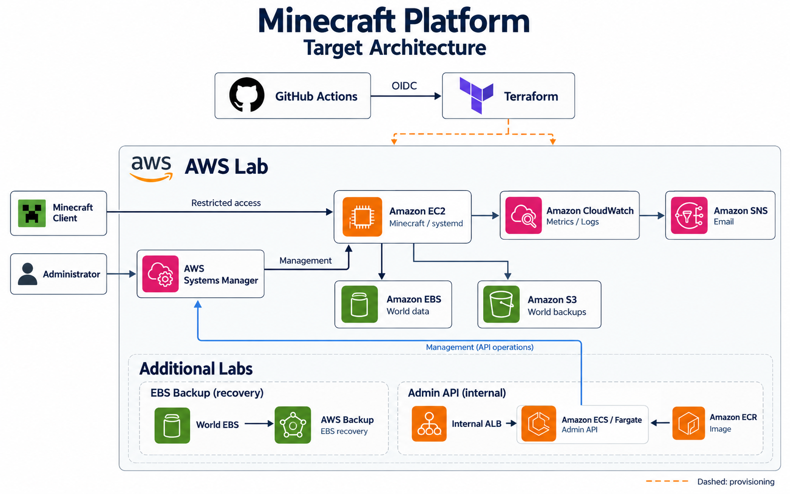

# Minecraft Platform

Minecraft サーバーを題材に、AWS インフラの構築から監視・バックアップ・障害復旧・撤去までの設計と作成の流れを学ぶ、個人学習用プロジェクトです。学習後は廃棄する想定で、コードと設計意図の理解を重視しています。

Terraform で EC2 と World 用 EBS を構築し、Systems Manager から管理します。サーバー交換時には World を引き継ぎ、サーバーやディスクを失った場合にはバックアップから復旧できる構成を目指しています。

完成時には、GitHub Actions と OIDC による変更管理、CloudWatch による監視、小さな管理 API のコンテナ運用を組み合わせ、環境の再構築から障害対応、費用確認と撤去までを一通り検証できるようにします。

## 完成時の構成

ECS、ALB、AWS Backup などは、それぞれの演習時に作成する設計です。実行環境とバックアップの寿命を分け、復旧を確認してから不要なデータも整理します。

## 技術的な特徴

完成時に目指す機能と設計は以下のとおりです。

| 観点 | 内容 |
| --- | --- |
| Infrastructure as Code | Terraform で基盤、実行環境、バックアップ領域を分けて管理 |
| データ管理 | EC2 と独立した EBS に World を保存し、サーバー交換時に再利用 |
| 起動前の確認 | EBS の ID とファイルシステムの UUID を確認し、誤った保存先での起動を拒否 |
| 管理経路 | Systems Manager を使用し、SSH や RCON を外部公開しない |
| バックアップ・復旧 | Minecraft の停止・保存を確認してバックアップし、version と checksum を指定して復元 |
| 監視 | CPU・メモリ・ディスク・ログを観測し、CPU・メモリのアラームを SNS で通知 |
| CI/CD | 静的検査、変更内容のレビュー、OIDC 認証による AWS 操作を組み合わせる |
| コンテナ運用 | 必要な演習で管理 API を ECR・ECS/Fargate・internal ALB に配置し、ロールバックまで確認 |
| コスト管理 | 短時間の演習ごとに構築・確認・撤去し、生成物と残課金も確認 |

## 主な設計判断

### サーバーと World を分離する

EC2 を交換する操作と、World を削除する操作を分けます。起動前にはマウント先、EBS の ID、UUID を確認し、ディスクの接続ミスで別の場所に空の World を作ることを防ぎます。

### バックアップは復旧まで確認する

バックアップの取得成功に加え、新しい環境へ戻した World と、失われた変更の範囲を確認します。S3 の version と checksum を使い、どの復旧点を使ったか追跡できる設計です。

### 管理操作の入口と権限を絞る

サーバー管理には Systems Manager を使用します。管理 API は internal ALB の背後に配置し、対象と操作を限定した SSM Document を呼び出す設計です。GitHub Actions からの AWS 操作には OIDC を使い、長期アクセスキーを保存しません。

### 演習ごとに撤去する

学習用のテスト World を使い、環境を必要なときに作成します。終了時には実行環境と不要なバックアップを撤去し、Terraform の状態だけでなく AWS 側の残置と費用も確認します。Terraform state などの管理基盤は、通常の演習環境と分けて扱います。

## 技術スタック

| 分野 | 技術 | 用途 |
| --- | --- | --- |
| AWS 基盤 | VPC、EC2、EBS、S3 | ネットワーク、Minecraft サーバー、World の保存 |
| Infrastructure as Code | Terraform、AWS provider | リソースの定義、変更、再構築、撤去 |
| サーバー | Minecraft Java Edition、Linux、systemd | 起動・停止とサービス管理 |
| スクリプト・テスト | Bash、Python | ストレージ確認、バックアップ・復旧、模擬テスト |
| セキュリティ | IAM、Security Group、Systems Manager、KMS | 最小権限、通信制限、管理経路、暗号化 |
| 監視 | CloudWatch、CloudWatch Agent、SNS | メトリクス・ログ収集と通知 |
| バックアップ演習 | AWS Backup | オンデマンドEBSバックアップ・復旧用の定義 |
| CI/CD | GitHub Actions、OIDC、TFLint、Trivy | 認証、構文・設定・セキュリティの検査 |
| 追加演習で使用予定 | Go、Docker、ECR、ECS/Fargate、internal ALB | 管理 API のコンテナ運用 |

## このプロジェクトで学ぶこと

- **AWS と Terraform**：ネットワーク・サーバー・ストレージの関係を理解し、同じ構成をコードから再現する。
- **Linux とセキュリティ**：プロセス、ディスク、ファイル権限、IAM と通信経路を管理する。
- **監視と障害調査**：メトリクスとログを使い、異常の原因と修正前後の違いを説明する。
- **バックアップと復旧**：整合性のあるデータを保存し、復旧にかかる時間と失われる変更を確認する。
- **CI/CD とコンテナ**：変更を検査して反映し、デプロイに失敗した場合に以前の状態へ戻す。
- **費用とリソース管理**：環境とデータの寿命を決め、撤去後の残置や課金も確認する。

## コードの配置

| ディレクトリ | 内容 |
| --- | --- |
| infra/ | Terraformの基盤・実行環境・データ・KMS演習 |
| scripts/ | ストレージ確認、backup/restore、ロールバック |
| systemd/ | Minecraftと監視Agentの設定例 |
| assets/ | 構成図 |
| .github/ | AWS認証を使わない静的CI |

## 現在の状態

EC2 上での Minecraft 起動・接続、World 用 EBS を維持した EC2 交換、演習環境の撤去を過去に AWS で確認しています。バックアップ・復旧、監視・通知、更新前のファイルへ戻すコードと、AWS Backup・独立KMS演習の定義を用意しました。撤去と障害対応の設計は学習資料にまとめています。現在は AWS にデプロイせず、実装と学習用の説明を中心に進めています。一連の実 AWS 復旧・通知確認と、コンテナ運用などの追加演習は未実施です。
