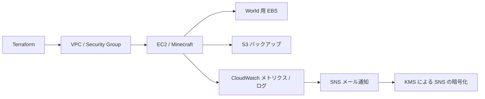

# Minecraft Platform

Minecraft のサーバーを題材に、AWS 上のインフラを Terraform で構築し、監視・バックアップ・復旧・撤去までを学ぶ個人プロジェクトです。

サーバーを常時稼働させるのではなく、必要なときに環境を作り、演習後に片付ける短時間のラボとして設計しています。

## 構成

EC2 と World 用 EBS を分けることで、サーバーを交換してもデータを引き継ぐ構成です。管理経路には Systems Manager を使用し、SSH を公開しない方針です。

## 現在の進捗

| 項目 | 状態 |
| --- | --- |
| EC2・Minecraft | 短時間の AWS 演習で起動・接続・撤去を確認済み |
| World 用 EBS | 別ボリュームのマウント確認と EC2 交換後のデータ引き継ぎを AWS で確認済み |
| バックアップ・復旧 | S3 を使うバックアップ／復旧コードとローカル模擬テストを作成。実 AWS での一連の復旧確認は未実施 |
| 監視・通知 | CPU・メモリのアラーム、ログ収集、SNS 通知をローカルで定義。実 AWS への配置・通知確認は未実施 |
| CI | Terraform の書式・構文、TFLint、セキュリティ検査と模擬テストを GitHub Actions に定義。直近の変更での CI 実行結果は未確認 |

演習後の撤去は過去に確認していますが、現在の AWS リソースの状態や請求額をこの README で保証するものではありません。

## 使用技術

- **AWS**：VPC、EC2、EBS、S3、IAM、Systems Manager、CloudWatch、SNS、KMS
- **インフラと CI**：Terraform、GitHub Actions、TFLint、Trivy
- **サーバー・処理**：Minecraft Java Edition、Linux、systemd、Bash、Python

ECS/Fargate、AWS Backup、復旧演習の拡充は今後の学習対象です。

## ディレクトリ

| 場所 | 内容 |
| --- | --- |
| `infra/bootstrap/` | Terraform state や GitHub Actions の認証に関わる基盤 |
| `infra/environments/lab/session-runtime/` | ネットワーク、EC2、EBS、監視など演習用の実行環境 |
| `infra/environments/lab/session-data/` | バックアップ用 S3 など、実行環境と分けるデータ領域 |
| `systemd/` | Minecraft と CloudWatch Agent の設定例 |
| `scripts/` | ストレージ確認、バックアップ、復旧の処理 |
| `tests/` | ローカルでの模擬テスト |
| `.github/workflows/` | 静的検査とテストの CI |

## 運用方針

- 学習用データを使い、演習ごとに作成・確認・撤去を行います。
- 実 AWS の操作前に、対象アカウント、既存リソース、変更内容、費用を確認します。
- 監視用 SNS の専用 KMS キーは AWS で作成すると料金が発生します。
- 入力値、Terraform state、Plan、個人用メモ、詳細な設計資料と証跡はリポジトリに含めません。

現在はローカル作業を進めており、Terraform provider のロックファイルの再確認と、Minecraft・JDK の更新候補の検証が残っています。重要なデータや第三者向けサービスへの利用は想定していません。
