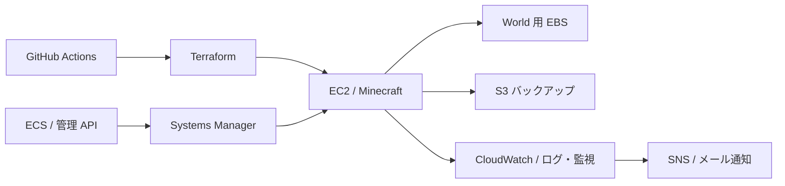

# Minecraft Platform

Minecraft サーバーを題材に、AWS のインフラを構築・運用・復旧するための学習用プラットフォームを作っています。Terraform で環境を再現し、問題が起きたときの調査や復旧、演習後の撤去までを一通り実践するプロジェクトです。

## 完成するとできること

- **環境を作る**：Terraform でネットワーク、Minecraft サーバー、World 用ディスクを構築し、本人が接続して動作を確認する。
- **状態を調べる**：CPU・メモリ・ディスクの使用状況とログを確認し、CPU・メモリのアラームをメールで受け取る。
- **データを復旧する**：World を S3 にバックアップし、サーバーやディスクを作り直したあとに復元する。AWS Backup での復旧も別の演習として行う。
- **変更を管理する**：GitHub Actions と AWS の OIDC 認証を使い、変更内容やテスト結果を確認してから反映する。
- **管理機能を試す**：必要な演習で、ECS/Fargate 上の小さな管理 API とコンテナのデプロイ・ロールバックを試す。
- **安全に終了する**：演習結果を記録し、不要なリソースと一時データを撤去して、残置と費用を確認する。

実行環境は常時稼働させず、学習するときに作成します。使い捨てのテスト World を対象とし、重要なデータや第三者向けサービスには使用しません。

## 完成時の構成イメージ

管理には Systems Manager を使用し、SSH を外部公開しない設計です。ECS や AWS Backup などは必要な演習時だけ使用します。演習中のバックアップは復旧確認まで保持し、終了時に不要なデータとともに整理します。

## 技術スタック

| 分野 | 技術 | 用途 |
| --- | --- | --- |
| インフラ | AWS VPC、EC2、EBS、S3 | ネットワーク、サーバー、World の保存とバックアップ |
| インフラの構築 | Terraform、AWS provider | AWS リソースの定義、変更、撤去 |
| サーバー | Minecraft Java Edition、Linux、systemd | サーバーの起動・停止とサービス管理 |
| セキュリティ | IAM、Security Group、Systems Manager、KMS | 権限管理、通信制限、安全な管理経路、暗号化 |
| 監視 | CloudWatch、CloudWatch Agent、SNS | メトリクス・ログの収集とメール通知 |
| 自動化・テスト | Bash、Python | バックアップ・復旧処理とローカル模擬テスト |
| CI/CD | GitHub Actions、OIDC、TFLint、Trivy | 認証、Terraform の検査、セキュリティ検査 |
| 今後の演習 | AWS Backup、Docker、ECR、ECS/Fargate、internal ALB | バックアップ復旧と管理 API のコンテナ運用 |

## このプロジェクトで学ぶこと

- **AWS と Terraform**：ネットワーク、サーバー、ストレージの関係と、構成をコードで再現・変更する方法。
- **Linux とサーバー運用**：systemd によるプロセス管理、ディスクのマウント確認、ログを使った調査。
- **セキュリティ**：最小権限、通信制限、暗号化、SSH を公開しない管理方法。
- **監視と障害対応**：メトリクスとログから異常を見つけ、原因を調べる方法。
- **バックアップと復旧**：データを保存し、サーバー消失後に復元する手順と、失われる変更の範囲。
- **CI/CD とコンテナ**：変更の検査、GitHub Actions からの認証、コンテナのデプロイとロールバック。
- **費用と撤去**：AWS リソースの寿命を管理し、演習終了後に残置と費用を確認する方法。

## 現在の状態

EC2 上での Minecraft 起動・接続と、World 用 EBS を維持した EC2 交換・撤去を AWS で確認済みです。バックアップ・復旧と監視・通知はコードを準備しましたが、一連の実 AWS 検証はこれからです。現在はローカル作業を進めています。
